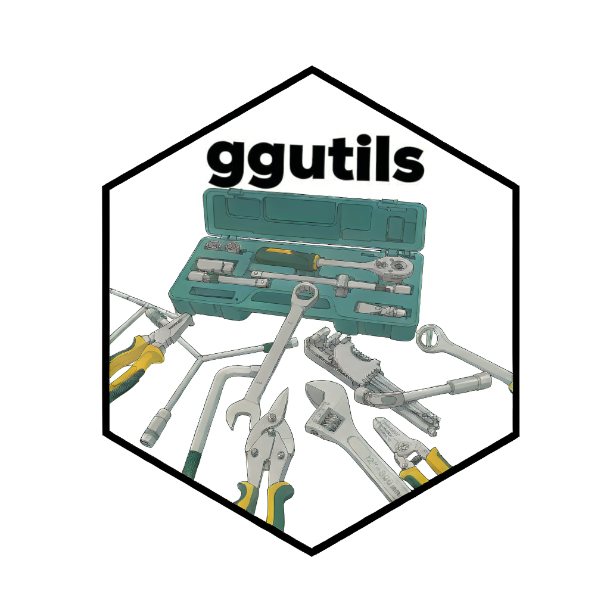

<!-- README.md is generated from README.Rmd. Please edit that file -->

# ggutils



[](https://github.com/junjunlab/ggutils/actions/workflows/R-CMD-check.yaml)
[](https://lifecycle.r-lib.org/articles/stages.html#experimental)
[](https://opensource.org/licenses/MIT)
[](https://cran.r-project.org/)
[](https://ggplot2.tidyverse.org/)
[](https://junjunlab.github.io/ggutils/)

> Small, reusable utilities for `ggplot2`.

`ggutils` adds helpers that plug into the usual grammar -- no new geometry, no
special data format -- so a plot keeps being a plot. Each one solves a concrete
problem and is documented with runnable examples.

What is inside:

- **`guide_axis_smart()`** -- readable labels on crowded axes: pick the labels
  (`which`, `n`), spread them over several rows / columns without overlap, and
  tie every label back to its tick with a leader line.
- **`guide_axis_cluster()` / `scale_x_cluster()` / `scale_y_cluster()`** --
  hierarchical clustering on the axes: the axis is ordered by the dendrogram and
  the tree is drawn next to it, one tree per panel with free facets. On a
  `coord_radial()` plot the theta tree becomes a ring dendrogram (inside the hole
  or outside the circle) and a partial arc gets an arc-shaped r-axis tree.
- **`facet_gridn()`** -- `facet_grid()` with scales that are free per panel
  instead of per row / column.
- **`coord_spiral()`** -- an Archimedean spiral coordinate with matching angle
  and radial axes, for long sequences that would otherwise need many rows.
- **Data and layout helpers** -- the bundled `airway_heatmap`, `pbmc3k_markers`
  and `pbmc3k_dotplot` data, plus the exported layout algorithms
  `smart_align()`, `box_arrange()` and `smart_stack()`.

## Installation

Requires R >= 4.1 and **ggplot2 >= 4.0.0**.

```{r install, eval = FALSE}
# install.packages("remotes")
remotes::install_github("junjunlab/ggutils")
```

## Documentation

- **Reference manual**: <https://junjunlab.github.io/ggutils/reference/>
- **English vignette**: <https://junjunlab.github.io/ggutils/articles/ggutils-en.html>

## Credits

The overlap-free label compaction is a port of `smartAlign` from **circlize**;
the box arrangement is a port from **ComplexHeatmap**. The ggplot2 guide
integration is new.
