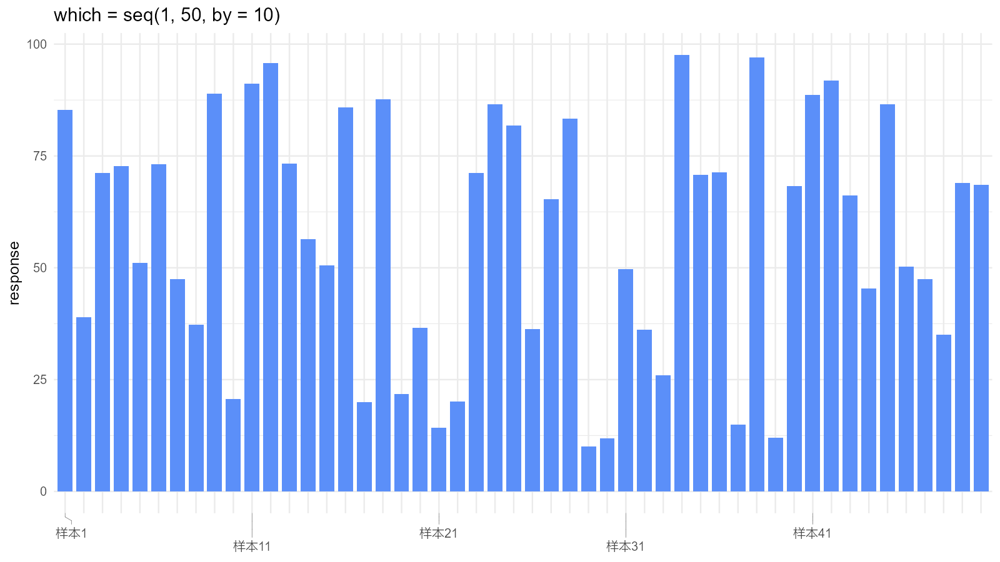
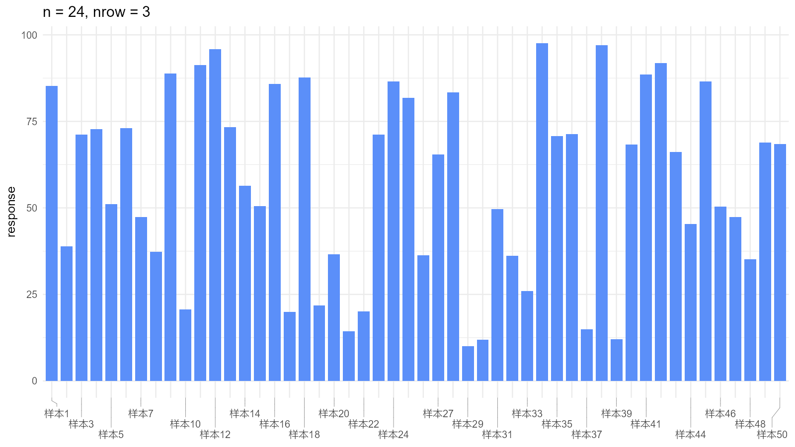
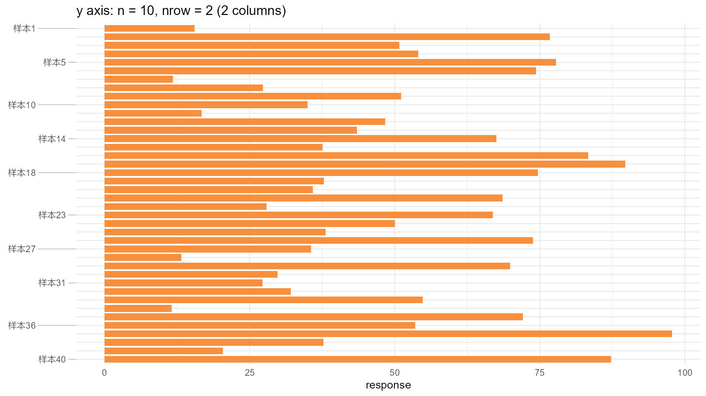
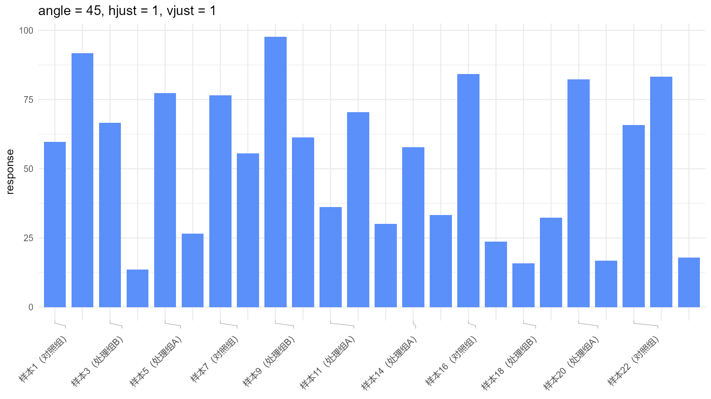
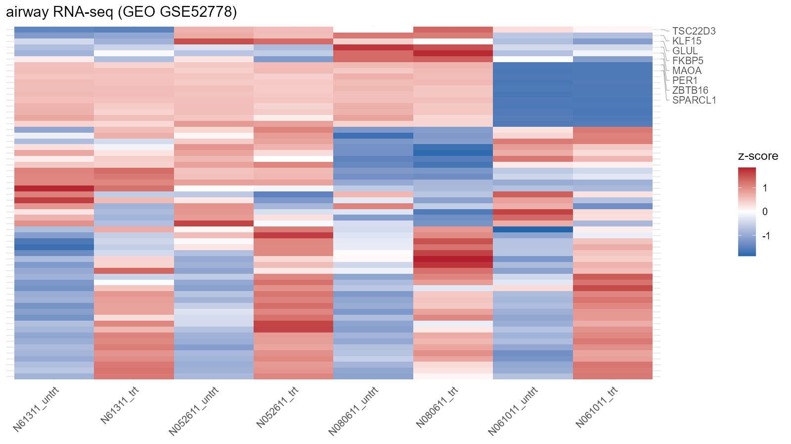
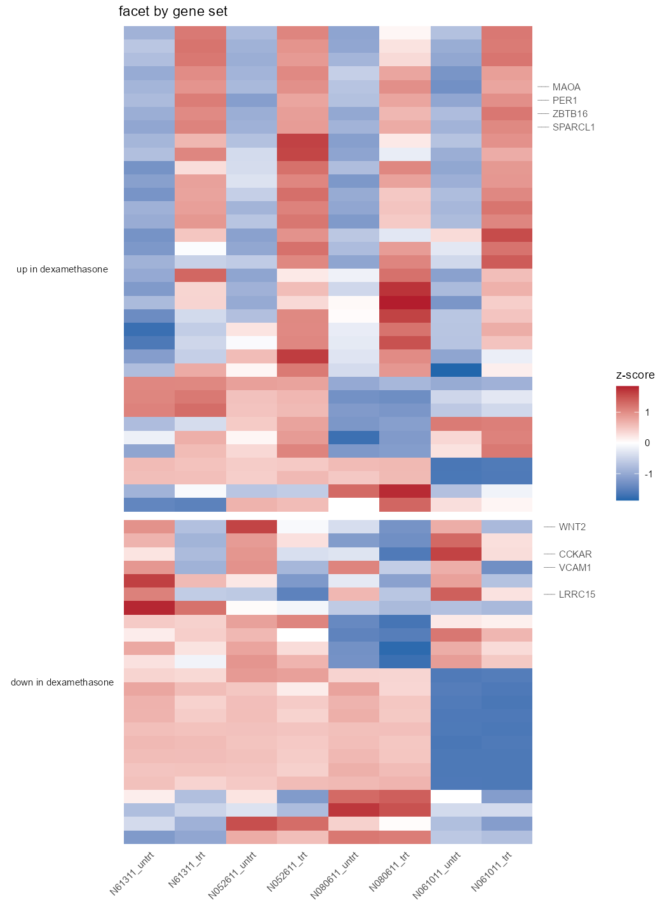

<!-- README.md is generated from README.Rmd. Please edit that file -->

# ggsmartext

> Smart axis labels for ggplot2: show only the categories you care
> about, connect each label to its tick with a leader line, and stagger
> the labels over several rows so that the space outside the axis is
> actually used.

When a discrete axis carries many categories (50 samples, 200 features,
…) the stock `ggplot2` axis draws every label on a single line. The
labels overlap, or you rotate them all by 90°, or you hide them and lose
the information. `ggsmartext` adds `guide_axis_smart()`, a `GuideAxis`
subclass that takes over label drawing:

- **Choose the labels**: `which =` (integer index / label text / logical
  vector / function) or `n =` (auto-pick at most `n` labels, evenly
  spaced).
- **Use the page**: labels are packed without overlap
  (`smartAlign`-style one-dimensional compaction) and distributed over
  `nrow` rows (x axis) or columns (y axis). Rows are only added when
  they are needed: labels stretch along the axis when a single row fits,
  clustered labels are stacked automatically.
- **Never overlaps**: if there is no room left, labels are dropped
  instead of being printed on top of each other.
- **Leader lines**: every displayed label is tied back to its tick, by
  default with the `circlize` / `ComplexHeatmap::anno_mark()` “diagonal”
  geometry (short perpendicular stub, diagonal, short stub);
  `connection_style = "straight"` and `"elbow"` are also available.

## Installation

Requires R \>= 4.1 and **ggplot2 \>= 4.0.0** (the guide API used here
was rewritten in ggplot2 4.0).

``` r
# install.packages("remotes")
remotes::install_github("junjunlab/ggsmartext")
```

Or, from a local clone of the repository:

``` r
# install.packages("remotes")
remotes::install_local(".")
# or, from a shell:
# R CMD INSTALL .
```

## Documentation

The complete reference manual — every function, argument and example —
is published on the package documentation site:

- **Reference manual**:
  <https://junjunlab.github.io/ggsmartext/reference/>
- **中文 vignette（入门与全部用法）**:
  <https://junjunlab.github.io/ggsmartext/articles/ggsmartext.html>
- **English vignette**:
  <https://junjunlab.github.io/ggsmartext/articles/ggsmartext-en.html>

The vignettes walk through label selection (`which`), automatic
selection (`n`), staggered rows (`nrow`), the three leader-line styles,
vertical axes, facets and heatmap annotation; the reference manual
documents every argument and default.

## Pick the labels you need

``` r
ggplot(df, aes(x = sample, y = value)) +
  geom_col(fill = "#5B8FF9", width = 0.8) +
  guides(x = guide_axis_smart(which = seq(1, 50, by = 10), nrow = 2)) +
  labs(x = NULL, y = "response",
       title = "which = seq(1, 50, by = 10)") +
  theme_minimal(base_size = 12)
```

<div class="figure">


<p class="caption">

which = seq(1, 50, by = 10): every tenth category
</p>

</div>

`which` accepts an integer index vector, a character vector of labels, a
logical vector (one entry per label) or a function
`function(labels, positions)` that returns a logical vector (`positions`
are 0..1 axis-relative coordinates). `n` caps the final number of
labels: `which` selects first, `n` then keeps at most `n` of them evenly
spaced; with `which = NULL`, `n` picks directly from all labels.

## Stagger over several rows

``` r
ggplot(df, aes(x = sample, y = value)) +
  geom_col(fill = "#5B8FF9", width = 0.8) +
  guides(x = guide_axis_smart(n = 24, nrow = 3)) +
  labs(x = NULL, y = "response", title = "n = 24, nrow = 3") +
  theme_minimal(base_size = 12)
```

<div class="figure">


<p class="caption">

nrow = 3: three staggered rows make room for more labels
</p>

</div>

On a y axis `nrow` means *columns* of labels:

``` r
labs <- paste0("样本", 1:40)
df_y <- data.frame(
  sample = factor(labs, levels = rev(labs)),
  value = round(runif(40, 10, 100), 1)
)

ggplot(df_y, aes(x = value, y = sample)) +
  geom_col(fill = "#F6903D", width = 0.8) +
  guides(y = guide_axis_smart(n = 10, nrow = 2)) +
  labs(x = "response", y = NULL,
       title = "y axis: n = 10, nrow = 2 (2 columns)") +
  theme_minimal(base_size = 12)
```

<div class="figure">


<p class="caption">

y axis: n = 10 labels laid out in nrow = 2 columns
</p>

</div>

## Long labels: rotate instead of stacking

``` r
trt <- rep(c("对照组", "处理组A", "处理组B"), 8)
labs <- paste0("样本", 1:24, "（", trt, "）")
df_long <- data.frame(
  sample = factor(labs, levels = labs),
  value = round(runif(24, 10, 100), 1)
)

ggplot(df_long, aes(x = sample, y = value)) +
  geom_col(fill = "#5B8FF9", width = 0.8) +
  guides(x = guide_axis_smart(n = 12, nrow = 1, angle = 45, hjust = 1, vjust = 1)) +
  labs(x = NULL, y = "response", title = "angle = 45, hjust = 1, vjust = 1") +
  theme_minimal(base_size = 12)
```

<div class="figure">


<p class="caption">

angle = 45, hjust = 1, vjust = 1
</p>

</div>

## Heatmap-style annotation (`anno_mark`)

This is the geometry of `ComplexHeatmap::anno_mark()`: hide the full
axis and label only the rows you care about. Duplicate the axis with
`dup_axis()`, switch the main guide off with `guide_none()`, and put
`guide_axis_smart()` on the copy.

The data is real: the
[`airway`](https://bioconductor.org/packages/airway) package holds an
RNA-seq experiment on human airway smooth muscle cells (GEO
[GSE52778](https://www.ncbi.nlm.nih.gov/geo/query/acc.cgi?acc=GSE52778)),
four cell lines with and without dexamethasone. The heatmap shows 300
genes and labels 20 of them, so the way leader lines and the vertical
spacing of the labels are allocated is clearly visible:

``` r
## real RNA-seq data from GEO: airway (GSE52778), 4 cell lines +/- dexamethasone
library(airway)
data(airway, package = "airway")

counts <- SummarizedExperiment::assay(airway, "counts")
cpm <- t(t(counts) / colSums(counts)) * 1e6
logcpm <- log2(cpm[rowSums(cpm > 1) >= 4, ] + 1)

## drop duplicated gene symbols so that every label is unique
name_map <- SummarizedExperiment::rowData(airway)$symbol
name_map <- ifelse(is.na(name_map) | name_map == "", rownames(airway), name_map)
names(name_map) <- rownames(airway)
dup_ids <- names(name_map)[duplicated(name_map) | duplicated(name_map, fromLast = TRUE)]
logcpm <- logcpm[!rownames(logcpm) %in% dup_ids, ]

n_gene <- 300
vars <- apply(logcpm, 1, var)
z <- t(scale(t(logcpm[names(sort(vars, decreasing = TRUE))[seq_len(n_gene)], ])))
ord <- hclust(dist(z), method = "ward.D2")$order
gene_name <- name_map[rownames(z)]

cd <- as.data.frame(SummarizedExperiment::colData(airway))
delta <- rowMeans(z[, cd$dex == "trt"]) - rowMeans(z[, cd$dex == "untrt"])
gene_set <- ifelse(delta > 0, "up in dexamethasone", "down in dexamethasone")
sample_lab <- factor(paste(cd$cell, cd$dex, sep = "_"),
                     levels = paste(cd$cell, cd$dex, sep = "_"))

df_gene <- data.frame(
  gene = factor(rep(gene_name[ord], times = nrow(cd)), levels = rev(gene_name[ord])),
  sample = factor(rep(sample_lab, each = nrow(z)), levels = levels(sample_lab)),
  gene_set = factor(rep(gene_set[ord], times = nrow(cd)),
                    levels = c("up in dexamethasone", "down in dexamethasone")),
  z = as.vector(z[ord, ])
)

## 12 neighbouring genes + 8 scattered ones
mark <- c(
  gene_name[ord][1:12],
  gene_name[ord][round(seq(60, n_gene - 10, length.out = 8))]
)

ggplot(df_gene, aes(x = sample, y = gene, fill = z)) +
  geom_tile() +
  scale_y_discrete(
    guide = guide_none(),
    sec.axis = dup_axis(
      guide = guide_axis_smart(which = mark)
    )
  ) +
  scale_fill_gradient2(low = "#2166ac", mid = "white", high = "#b2182b",
                       midpoint = 0, name = "z-score") +
  labs(x = NULL, y = NULL, title = "airway RNA-seq (GEO GSE52778), 300 genes") +
  theme_minimal(base_size = 9) +
  theme(axis.text.x = element_text(angle = 45, hjust = 1))
```

<div class="figure">


<p class="caption">

Real RNA-seq data (GEO GSE52778): a tall 300-gene heatmap, only 20 genes
are labelled on a duplicated right axis
</p>

</div>

Facets work as well, and every panel lays out its own labels: split the
genes into an “up” and a “down” panel and label the four strongest
responders in each.

``` r
mark_by_set <- lapply(
  split(names(delta), gene_set),
  function(ids) ids[order(abs(delta[ids]), decreasing = TRUE)][1:4]
)
mark_facet <- unlist(mark_by_set, use.names = FALSE)

ggplot(df_gene, aes(x = sample, y = gene, fill = z)) +
  geom_tile() +
  facet_grid(gene_set ~ ., scales = "free_y", space = "free_y", switch = "y") +
  scale_y_discrete(
    position = "right",
    guide = guide_axis_smart(
      which = function(labels, positions) labels %in% gene_name[mark_facet]
    )
  ) +
  scale_fill_gradient2(low = "#2166ac", mid = "white", high = "#b2182b",
                       midpoint = 0, name = "z-score") +
  labs(x = NULL, y = NULL, title = "facet by gene set, 300 genes") +
  theme_minimal(base_size = 9) +
  theme(panel.grid = element_blank(),
        strip.placement = "outside",
        strip.text.y.left = element_text(angle = 0),
        axis.text.x = element_text(angle = 45, hjust = 1))
```

<div class="figure">


<p class="caption">

Faceted heatmap (GEO GSE52778): each panel has different data and lays
out its own labels
</p>

</div>

`airway` is a `Suggests` dependency; install it with
`BiocManager::install("airway")` when you re-render this README.

The same works for a cluster of neighbouring categories: select it with
`which = 24:35` and the guide stacks the labels over several rows
automatically (`nrow = 1` forces the single-row `anno_mark` look
instead).

## Main arguments

| argument | default | meaning |
|----|----|----|
| `which` | `NULL` | labels to show: integer index / character / logical / function |
| `n` | `NULL` | hard cap on the number of labels shown (evenly spaced) |
| `nrow` | `NULL` | number of label rows (x axis) or columns (y axis); `NULL` = auto |
| `padding`, `gap` | `0.25`, `0.30` | minimum box spacing / track spacing, relative to label height |
| `extend` | `0` | allow labels to exceed the panel by this fraction (0..0.5); `0` keeps every label inside the panel |
| `connection`, `connection_style` | `TRUE`, `"diagonal"` | draw leader lines; `"diagonal"`, `"straight"` or `"elbow"` |
| `link_length` | `3` | length (mm) of the leader segment between the axis and the first label track |
| `connection_col/lwd/lty` | `NULL`, `0.5`, `1` | leader line style |
| `tick` | `"all"` | ticks: `"all"`, `"shown"` or `"none"` |
| `angle`, `hjust`, `vjust` | `NULL` | label rotation, `NULL` inherits the theme |
| `panel_width` | `NULL` | panel width (cm) used to estimate the number of rows |
| `max_nrow` | `8` | upper bound on the automatic number of label tracks |

## Learn more

- Two vignettes cover the same material: an English walkthrough in
  `vignette("ggsmartext-en", package = "ggsmartext")` and a Chinese one
  in `vignette("ggsmartext", package = "ggsmartext")`.
- The layout algorithms are exported and can be used on their own:
  `smart_align()` (a port of `circlize::smartAlign`), `box_arrange()` (a
  port of `ComplexHeatmap`’s box arrangement) and `smart_stack()`.
- Showcase scripts live in `inst/examples/`; `07-gallery.R` regenerates
  all figures used in the docs.

## Credits

The one-dimensional, overlap-free compaction is a port of the
`smartAlign` algorithm from the **circlize** package; the box
arrangement is a port of the **ComplexHeatmap** package. `ggsmartext`
only re-uses the algorithms — the ggplot2 guide integration is new.
